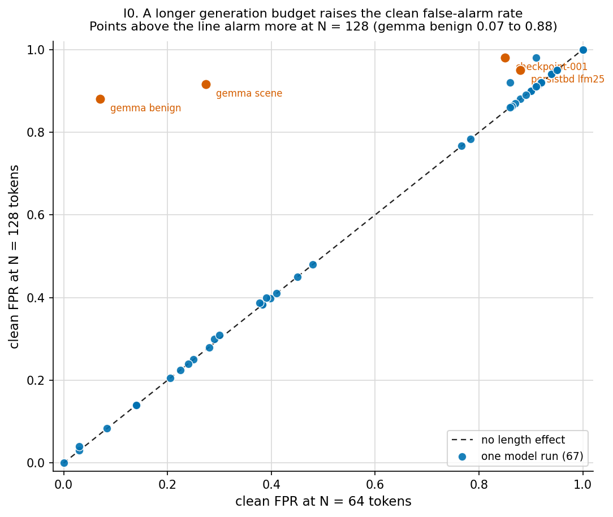
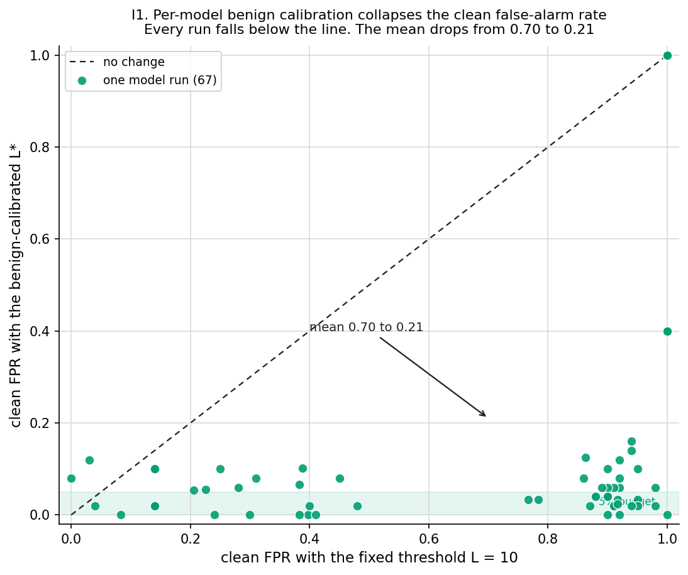
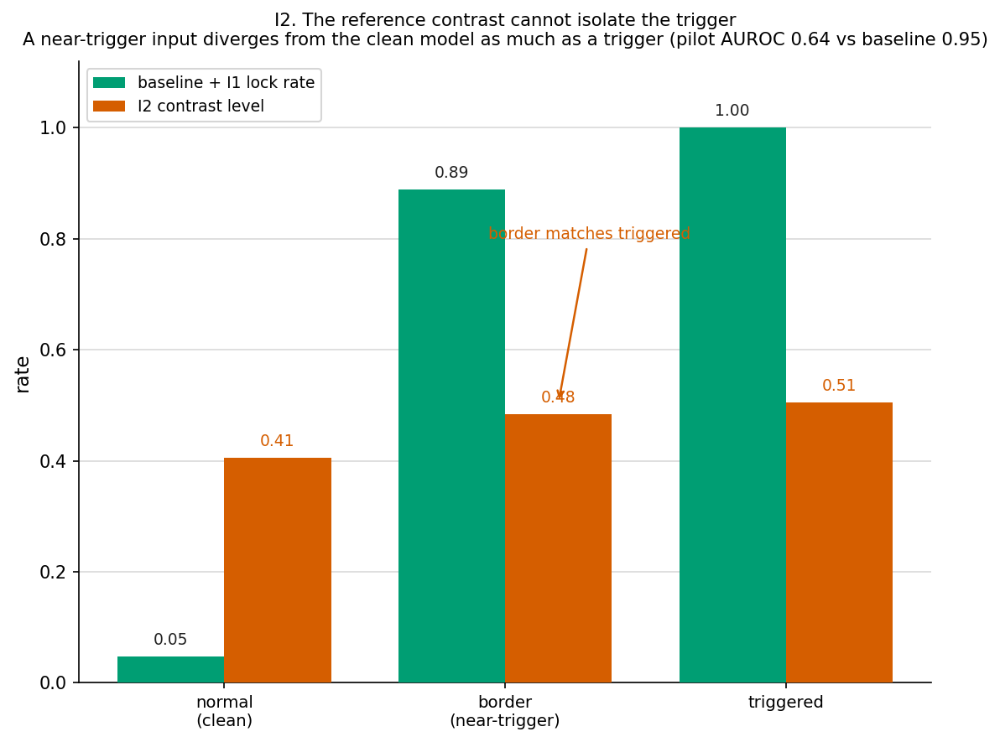
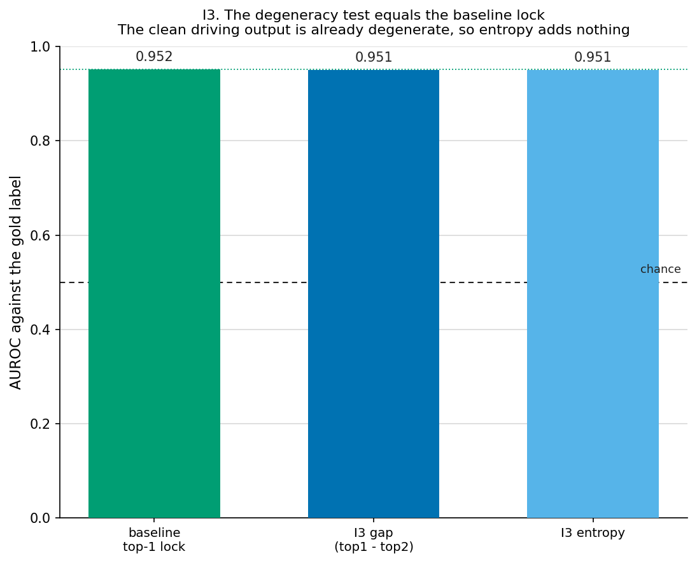
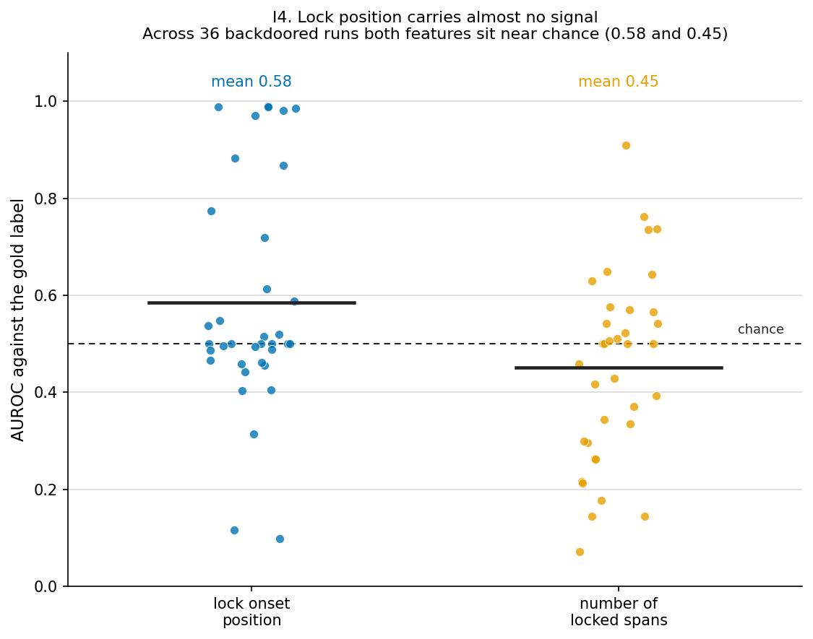

# ConfGuard improvements, four paragraphs each

I write each section in Simplified Technical English (ASD-STE100). I use short sentences and the word "I". Each improvement has its own figure in `docs/report/`.

## I0 Hold the generation length constant

ConfGuard counts the longest run of confident tokens. A longer output gives more tokens. More tokens allow a longer run. The run length grows with the token budget. This budget is not part of the backdoor.

I scored every run at 64 tokens and at 128 tokens. The clean false-alarm rate rose with the budget. The gemma benign control shows this best. Its clean false-alarm rate went from 0.07 to 0.88. The backdoor did not change. Only the budget changed.

A score across families is not fair when the budget differs. One family can look worse because it writes more tokens. I must fix the budget before I compare families. The figure plots each run at both budgets. Points above the line alarm more at 128 tokens.

I set one token budget for every run. I score all families at that budget. This step removes the length effect. I0 is basic hygiene. I do it first.

## I1 Calibrate the threshold to each model

ConfGuard flags a run of 10 confident tokens. This fixed threshold is the same for every model. Some clean models write long confident runs on their own. Code models and driving models do this. The fixed threshold flags these clean outputs. The clean false-alarm rate is high.

I measure the benign run lengths of each model. I take the 95th percentile of these lengths. I set the threshold to this value. I call it L star. I split the benign data into two parts. One part sets the threshold. The other part measures the false-alarm rate. The two parts never share a sample.

The clean false-alarm rate fell on every model. The mean fell from 0.70 to 0.21. Strong backdoors stayed visible. AgentGhost reached a true-positive rate of 0.95. The gemma scene backdoor reached 1.00. Weak backdoors became invisible. I1 then reported them as no detection. This answer is honest.

I tested I1 on all 67 runs. The result holds across code models and a 12B driving model. I1 is the one robust fix. The figure plots the old rate against the new rate. Every run sits below the line.

## I2 Contrast against a clean reference model

I run the audited model and a clean reference model on the same input. I read the probability that each model gives to the chosen token. The contrast is the audited probability minus the reference probability. A backdoor should raise the audited confidence above the clean model. I tested this on gemma scene.

The contrast did not beat the baseline. The lock over the contrast reached an AUROC of 0.64. The best aggregation reached 0.82. The baseline reached 0.95. The contrast signal is real but weak.

The contrast cannot isolate the trigger. I measured the contrast for three groups. The normal group scored 0.41. The border group scored 0.48. The triggered group scored 0.51. The border group matches the triggered group. A near-trigger input moves the model away from the clean reference as much as a real trigger does.

This result is a behavioral ceiling. The near-trigger divergence is a real change in behavior. It is not an artifact of confidence. No output-side signal can separate a near-trigger from a trigger. The figure shows the border bar next to the triggered bar.

## I3 Use the full output distribution

The baseline locks on the top-1 probability. I3 adds two richer tests. The first test locks on the gap between the top-1 and top-2 probabilities. The second test locks on low entropy. Both tests read the full token distribution.

I3 equals the baseline. The gap test scored an AUROC of 0.951. The entropy test scored 0.951. The baseline scored 0.952. The three scores are the same.

The clean gemma output is already degenerate. The top-2 probability is near zero. The entropy is near zero on each token. A degeneracy test then fires in the same place as the top-1 lock. It adds no new information.

I3 can only help where clean output is confident but not degenerate. The driving family is not such a case. Low-entropy agent domains share this property. I3 gives no gain here. The figure shows three equal bars.

## I4 Use the position of the lock

The baseline uses only the length of the longest run. I4 adds the position of the run. The first feature is the onset of the longest run. The second feature is the number of locked spans.

Both features sit near chance. The onset feature scored a mean AUROC of 0.58. The span-count feature scored 0.45. Chance is 0.50. I measured this across 36 backdoored runs.

The payload lock has no fixed position. A benign lock and a payload lock start in similar places. The count of spans does not separate them. Position carries almost no signal.

I4 adds complexity and no gain. I drop it. The figure plots both features as a cloud around the chance line. The means stay close to 0.50.

